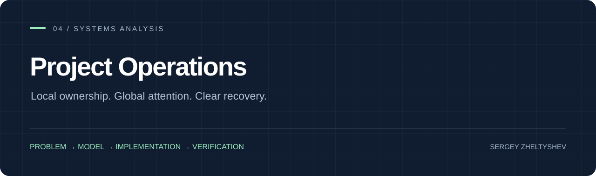

# Project Operations

A systems analysis case study and executable policy model for coordinating work across projects without duplicating the source of truth.

[Case study](docs/case-study.md) · [System design](docs/system-design.md) · [Contracts](docs/contracts.md) · [Requirements & verification](docs/requirements.md)

[](https://github.com/SeregaObr882/project-operations/actions/workflows/ci.yml)

## Why this exists

A global task board improves visibility but often becomes a second backlog. Work drifts between boards, context is lost after pauses and a selected priority gets confused with a workflow status.

## What the system does

Keep one canonical work item in its project. Derive global attention views by reference, separate attention from execution status, and use short recovery checkpoints that point back to the real source.

## Run the demonstration

```sh
python operations.py
python -m unittest discover -s tests -v
```

`output/attention.json` contains attention projections, an explicit WIP-capacity signal and project recovery checkpoints. The scenario is synthetic and uses Python standard library only.

[Inspect the sample output](examples/expected-output.json).

## The result

The reference scenario projects four work items into Today, Clarify and Blocked views while retaining their canonical IDs and project provenance. Executable policies reject missing blockers, invalid transitions, duplicate identities and completion without acceptance evidence.

## Engineering decisions

**Workflow and attention are orthogonal.** Ready/in progress/review describes project execution. Today/clarify/blocked describes global attention. Changing one does not silently change the other.

**A projection is a reference.** Global views carry canonical item IDs, project provenance and source pointers. They do not create separately editable work-item copies.

**Recovery is not reporting.** A checkpoint answers where to resume and which source to open. It is not a copied backlog or a chronological activity log.

**Capacity is visible, not destructive.** Three items is the default Today target. Over-capacity produces a signal while preserving the full selected set rather than hiding work.

## Repository map

```text
docs/case-study.md       # Problem, challenge, decisions and result
docs/system-design.md    # Process, ownership and entity model
docs/contracts.md        # Work-item and checkpoint contracts
docs/requirements.md     # Requirements-to-verification traceability
examples/work-items.json # Synthetic cross-project scenario
operations.py            # Executable reference policy
tests/test_operations.py # Policy and acceptance checks
```

## About this work

By **Sergey Zheltyshev — Systems Analyst & Software Engineer**. This repository connects problem framing, system contracts, implementation and verification. The public edition contains portable source and reproducible demonstration data; operational account material stays outside the release.

[Portfolio](https://github.com/SeregaObr882) · [License](LICENSE) · [Security](SECURITY.md)
