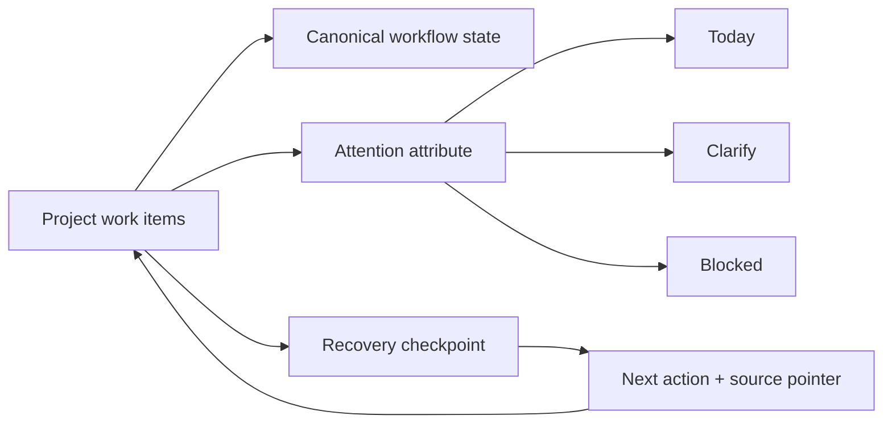

# System design

## System boundary

Keep one canonical work item in its project. Derive global attention views by reference, separate attention from execution status, and use short recovery checkpoints that point back to the real source.

## Responsibility separation

**Workflow and attention are orthogonal.** Ready/in progress/review describes project execution. Today/clarify/blocked describes global attention. Changing one does not silently change the other.

**A projection is a reference.** Global views carry canonical item IDs, project provenance and source pointers. They do not create separately editable work-item copies.

**Recovery is not reporting.** A checkpoint answers where to resume and which source to open. It is not a copied backlog or a chronological activity log.

**Capacity is visible, not destructive.** Three items is the default Today target. Over-capacity produces a signal while preserving the full selected set rather than hiding work.

## Quality attributes

- **Traceability:** behavior is linked to explicit contracts and verification scenarios.
- **Reproducibility:** the default public scenario uses synthetic data and needs no private account.
- **Maintainability:** data boundaries, state transitions and presentation are separate concerns.
- **Failure visibility:** invalid or incomplete inputs retain an explicit error or review path.

These are design properties with concrete checks in [requirements](requirements.md); they do not stand in for deployment load tests or an external service SLA.

[Contracts](contracts.md) · [Case study](case-study.md)
